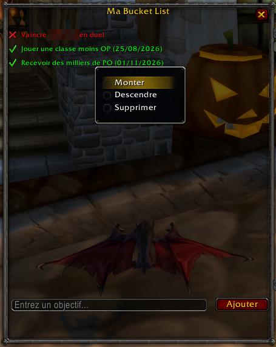

# BucketList

A personal in-game goals list for World of Warcraft Classic Era. Add your goals, check them off, reorder them and share them in chat.

*Screenshot from the French client, with a player name blurred.*

## Features

- Add goals and check them off with a left-click. The completion date is recorded.
- Right-click a goal to move it up or down, or to delete it (with confirmation).
- Share your list in group, raid, guild, say or yell.
- Your list and the window position are saved between sessions.
- Available in all 11 WoW client languages, selected automatically.

## Commands

- `/bucketlist` or `/bl`: open or close the window.
- `/bl share <group|raid|guild|say|yell>`: share your list in that channel.
- `/bl share guild 5`: share only the first 5 goals.

## Installation

1. Click **Code**, then **Download ZIP**.
2. Extract the archive and rename the folder `wow-era-BucketList-main` to `BucketList`. The addon does not load under any other folder name.
3. Move the `BucketList` folder to `World of Warcraft\_classic_era_\Interface\AddOns\`.
4. If the game is running, quit and restart it.

## License

GNU General Public License v3.0. See [LICENSE](LICENSE).
